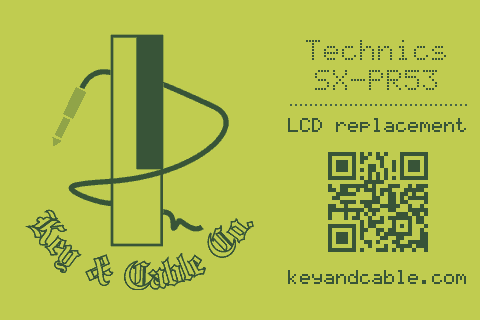
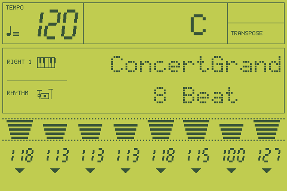
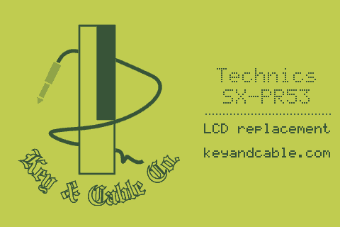

# Start-up screen with the Key & Cable Co. logo

Prototype, 2026-11-01, on branch `claude/happy-ritchie-c789eb`. The host tests
and previews pass and the Pico build compiles, but **it hasn't been flashed or
seen on the panel yet.**

The display Pico shows this from the moment the panel is set up until the
piano's play screen arrives. Then it repaints the whole glass:

On the right: the piano's own start-up text "Technics / SX-PR53" in the glass's
dot-matrix font, what the display is ("LCD replacement"), a QR code for
https://keyandcable.com, and the address. Everything is drawn in the glass's
palette, so the screen looks like part of the instrument and follows any theme
change in `pr53_theme.h`.

It's the customer's instrument, so the whole screen comes down to one setting
in `firmware/display/src/pr53_theme.h`:

    #define THEME_SPLASH     1   // 0 = no start-up screen, as the original
    #define THEME_SPLASH_QR  1   // 0 = no QR code (below)

## Recommendation: show the logo from power-up, and hand back when the piano's start-up screen ends

What the piano does when it starts, from `captures/restart_tap_v18_2026-10-31.log`
and the earlier logs:

| Time | Piano |
|---|---|
| 0 | LCD set-up: function set, display off, **CLEAR**, display on. A blank frame. |
| +2.6 s | "Technics" / "SX-PR53" |
| +5.3 s | Meters, tempo and part numbers load (about 50 ms) while "Technics" is still up |
| +5.4 s | The play screen: "ConcertGrand" / "8 Beat" |

The "Technics" screen doesn't always last 2.7 s. In
`captures/lcd_test_mode_2026-10-31.log` it stayed up for 12 s. After a
factory reset the piano shows "ALL INITIAL" instead (`startup_2026-10-31.log`).
CLEAR only ever comes at the piano's start-up.

- **(a) Logo for a fixed time from power-up.** No fixed time fits. Too short
  and the empty glass, then "Technics", show after it. Too long and it covers
  the play screen. "Until the first real frame" needs a test for "real",
  and that test is (b).
- **(b) Recognise the "Technics" screen and draw the logo instead.** On its
  own, the empty glass shows for the 2.6 s before "Technics".
- **Chosen: both.** The logo goes up at power-up and stays through every
  start-up frame: blank frames, and frames whose text is "Technics" /
  "SX-PR53" (either line may still be blank). The first other frame ends it.
  That frame also brings the meters and tempo, which load under the
  "Technics" text, so the glass appears complete in one repaint. A 30 s limit
  covers a piano that never gets past its start-up screen (the tap link down,
  the piano off, or the piano stuck on "Technics").

How it handles each case. All but the last were checked by `test_splash.c`
against the captures:

| Case | What happens |
|---|---|
| Display and piano powered together | The display is ready about 0.5 s after power-up (panel reset and set-up), then shows the logo. The piano's first LCD write comes later (not measured; its blank period alone lasts 2.6 s). Logo until "ConcertGrand", or until "ALL INITIAL" after a factory reset. |
| Piano restarts while the display stays on | This happens today: since IP101 is open, the carrier runs from USB, not the piano's 5 V (`hardware/carrier/README.md`). The logo comes back the moment the piano sets up its LCD: its CLEAR, which it sends only at start-up (all 11 in the captures sit in that set-up). It holds through the blank frames and "Technics" and hands back on the next real screen, so it also shows when the piano starts on "ALL INITIAL" (until 2026-11-02 it came back only with "Technics", so Greg saw no logo on those restarts). "Technics" arriving still brings it back too, in case the CLEAR was lost on the link. |
| Display restarts mid-session (reflash, brown-out) | The logo stays up until the piano sends a frame with anything lit, then the glass. If a frame is already waiting when the panel comes up, the logo only flashes for a few tens of ms. If the piano sits idle and sends nothing, the 30 s limit hands back, to the empty glass you'd get today. It never comes back on a blank frame: after a mid-session restart the decoder only knows what the piano has rewritten since, so blank-looking frames are normal then, and treating them as a start-up would make the logo flicker in and out. |
| LCD test mode (G4 + G5 at power-on) | The piano's first try in the capture set up the LCD and went quiet, so the 30 s limit hands back. Its segment test lights fields, which ends the logo at once. |
| Older taps that cut text short ("ConcertGran" over "SX-PR53") | Hands back on the changed line 1. |
| Real panel | **Not checked.** Needs a flash. |

**Hand-over.** The renderer repaints only changed fields, so the hand-over
runs `render_static()`, which fills the whole field and sets the "first
frame" flag, then `render_frame()` with the latest state. Every field gets
drawn, exactly as on the first frame after power-up today. Nothing of the
logo can survive it.

## The logo

**Source: `logo.svg` from the website** (`/mnt/keyandcable-files/key&cable/images/logo.svg`,
copied unchanged to `firmware/display/logo/keyandcable_logo.svg`). It's the
master vector: the site uses it as its favicon, its header mark and its
schema.org logo, and `logo.png` and `logo-quant.png` are exports of it.
Rasterising the vector straight to 260 px gives clean anti-aliased edges. The
other files in that folder are the same artwork: `logo_outline*.svg` is a cut
outline, and `key-and-cable-logo-1024.png` / `-avatar-circle.png` are square
crops. The carrier's back silkscreen has only the maker's text and a QR code,
no artwork.

The logo's colours map to four shades between the glass field and the segment
colour. The ivory key and letter fill become field, the outlines, black key and
cable become full ink, and the grey jack plug becomes a light tint. The
blackletter "Key & Cable Co." stays readable at this size, though its
outlines are thin; check it on the panel.

**QR code.** `qrencode` makes it at build time for https://keyandcable.com
(level M, 25 x 25 modules, 4 px each: 100 px, about 15 mm on the panel). It
was checked with an independent decoder written for the purpose (format bits,
unmasking, Reed-Solomon check), run on the firmware's own bit table in the
order `splash_draw()` draws it (row = y, bit = x): it reads
`https://keyandcable.com`, so it isn't mirrored or transposed. The carrier board's silkscreen QR
(`hardware/carrier/keyandcable_qr.txt`) decodes to the same URL. It uses level
L and mask 0, which is why it differs from this one. **Not verified: scanning
it on the real panel.** Dark segment green on the yellow-green field is about
5:1 contrast on the nominal colours, which phones normally manage, but the
panel's gamma changes that.

## Format and size

`firmware/display/logo/logo_to_c.py` turns the composed 480 x 320 greyscale
screen into **runs: one byte each, 2 bits of shade and 6 bits of length
(1-64 px)**, covering the whole screen in panel write order. The QR code is
one bit per module, one 32-bit word per row.

| Format | Size |
|---|---|
| Raw RGB565 frame | 300 KB |
| 2 bits per pixel, packed | 37.5 KB |
| **Runs, as used** | **7,072 bytes** (+ 100 bytes for the QR code) |

The Pico 2 has 4 MB of flash, so size was never the limit; the runs keep the
generated source file small and the drawing simple. `make -f host.mk logo`
remakes `src/pr53_logo.c` after a change to the logo or its placement. It needs
`rsvg-convert`, ImageMagick and `qrencode`. The generated file is committed,
so the Pico build needs nothing new.

**Drawing time.** The logo goes out as one full-screen window. Each run is a
single `ili9488_push(colour, n)`, which uses the same per-pixel loop as
`ili9488_fill_rect()`, so the bus timing is the one already proven on the
panel. In the built firmware, `ili9488_fill_rect()` inlines that same loop:
12 instructions per pixel, about 14 cycles, so about 95 ns at the SDK's
default 150 MHz. That gives:

| Part | Estimate |
|---|---|
| Logo, 153,600 pixels in 7,072 runs | about 15 ms |
| Text and QR code (about 900 small rectangles) | about 2-3 ms |
| Hand-over: `render_static()` + `render_frame()` | the same as today's first frame |

These figures come from counting instructions, not from timing it on the
board. Either way it's far below the piano's ~105 ms update tick, and the
logo is up about 0.5 s after power-up (most of that is the panel's reset and
set-up delays).
Firmware size: `pr53_fw.elf` text is 48.6 KB in all, of which the runs are
7 KB and the start-up code about 0.8 KB.

## The bus tap and decoding are untouched

- The tap firmware doesn't change.
- Core 0 (UART receive, HD44780 emulation, decoding, publishing) doesn't
  change. It keeps decoding every frame while the logo is up, so the glass is
  current the moment it hands back.
- Only core 1 changes: at power-up it draws the logo instead of the empty
  glass, and while the logo is up it reads each new frame but doesn't draw it.
  The hand-over repaint costs the same as the first frame does today.
- Shared resources: the 7 KB of runs are read from flash once per logo, which
  is no load on the flash cache core 0 runs from. Core 0 drives no GPIO.

## Files

- `firmware/display/src/pr53_splash.{h,c}`: when the screen shows
  (`splash_step()`) and what it draws (`splash_draw()`)
- `firmware/display/src/pr53_logo.{h,c}`: the runs and the QR code
  (`pr53_logo.c` is generated)
- `firmware/display/logo/`: the SVG and the converter
- `firmware/display/src/test_splash.c`: the host test, run by
  `make -f host.mk test`
- `src/main.c` (core 1 loop), `src/pr53_ili9486_par.{h,c}` (`ili9488_push()`),
  `src/pr53_theme.h` (the two settings, the logo shades), `src/preview.c`
  (runs the same rules; `AT=` picks a moment by tap time)

## Open points

- **Flash and look at it on the panel**, including a phone scan of the QR code.
- **Time from power-on to the piano's first LCD write** isn't in any capture
  (the tap was on USB each time). It only decides how long the logo is up
  before the blank period starts. A phone video of a cold start would show it.
- **The logo in a public, MIT-licensed repo.** The artwork is already public
  on the website, and the carrier silkscreen already carries the maker's mark.
  Greg may want a line saying the logo isn't covered by the code licence.
