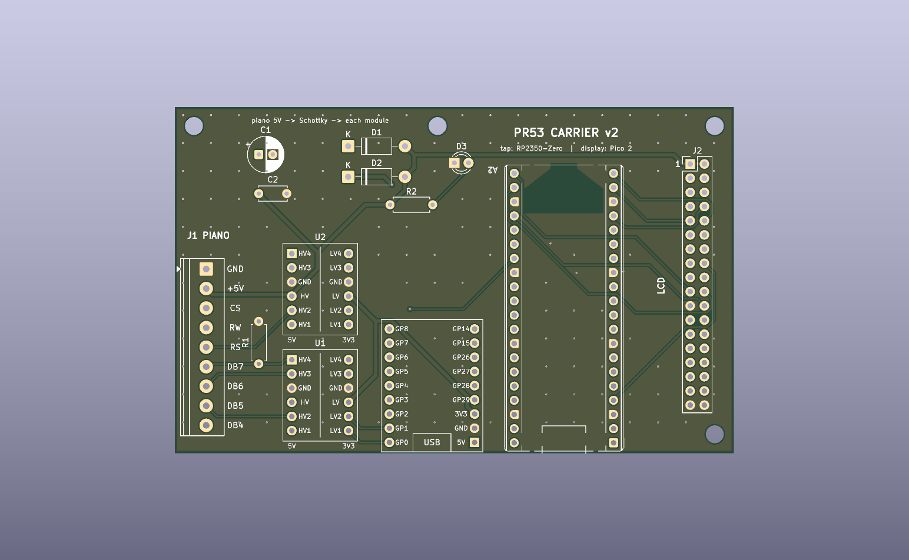
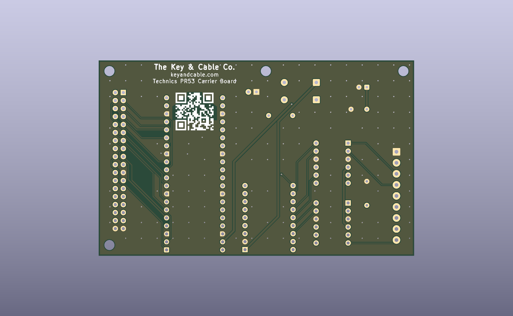

# PR53 Carrier Board (v2)

A 100 x 62 mm 2-layer board that carries the existing two-module build,
socketed on 2.54 mm headers:

    J1 piano in ──► U1/U2 BSS138 shifters ──► A1 RP2350-Zero (tap)
                                                   │ GP8 → GP21 link
                                                   ▼
                              J2 LCD out ◄── A2 Pico 2 (display)


**Status (v2): built and working** (first power-up 2026-10-31, on USB
power). J2 has to be fitted on the underside; see Bring-up below. Routed, DRC 0 errors / 0 unconnected (2
silkscreen-at-edge warnings on A2, same as v1), Gerbers in `gerbers/` and
`pr53_carrier_jlcpcb.zip`. Both module footprints are verified (table below).

**v1 (fabbed 2026-10) has the wrong shifter footprint.** Its rows are 12.70 mm
apart instead of 10.16 mm, and power and GND are swapped on both sides. A
shifter plugged straight into a v1 board is reverse-powered, so jumper LV,
HV and GND by hand. v1 files are kept in `rev1/`.




The back silkscreen carries the maker's mark (The Key & Cable Co. /
keyandcable.com / Technics PR53 Carrier Board) and a QR code to
https://keyandcable.com, drawn as vector squares from
`keyandcable_qr.txt` (0.48 mm modules, 12 mm). It sits between the
Pico's pin rows, inside a via-free zone so no drill hole lands in it.

## Module dimensions

| Module | Value | Source | Constant in `gen_footprints.py` |
|---|---|---|---|
| RP2350-Zero: long edge to long edge, pin centres | 15.24 mm (6 holes) | test-fitted on a v1 board | `ZERO_COL_SPACING` |
| BSS138 4-ch module: HV row to LV row | 10.16 mm (4 holes) | SparkFun's `.brd` | `SHIFTER_ROW_SPACING` |

Shifter pin order, module top view, HV row on the left and LV row on the
right, top to bottom: `HV4 HV3 GND HV HV2 HV1` and `LV4 LV3 GND LV LV2 LV1`.
Taken from SparkFun BOB-12009's own board file
(github.com/sparkfun/Logic_Level_Bidirectional, `Hardware/*.brd`), which the
cheap clones copy.

## Ordering (JLCPCB or similar)

Upload `pr53_carrier_jlcpcb.zip`. 2 layers, 1.6 mm, everything else default.
All traces are ≥ 0.25 mm, vias 0.7/0.35 mm, so nothing needs the expensive options.

## BOM (all through-hole, hand-solder)

| Ref | Part | Note |
|---|---|---|
| A1 | Waveshare RP2350-Zero + 2x 1x9 headers | USB-C at the bottom edge |
| A2 | Raspberry Pi Pico 2 + 2x 1x20 headers | USB at the bottom edge |
| U1, U2 | BSS138 4-ch level shifter module + 2x 1x6 headers each | |
| J1 | 9-pos 3.5 mm screw terminal (Phoenix PT 1,5/9-3.5-H, or 3+3+3 cheap KF350 blocks) | wire openings face the board edge |
| J2 | 2x18 2.54 mm male header | IDC ribbon → panel, pin 1 marked. **Fit it on the underside** (see Bring-up) |
| R1 | 10k axial | **DB7 busy-flag pulldown, needed for the board to work** |
| R2 | 1k axial | power LED |
| D1, D2 | 1N5819 Schottky | 5V into each module (blocks USB back-feed) |
| D3 | 3 mm LED | power |
| C1 | 100 µF 10 V radial, 2.5 mm pitch | |
| C2 | 100 nF ceramic, 5 mm pitch | |

Sockets (female headers) instead of soldering the modules down are a good idea.
The footprints are plain 2.54 mm holes, so either works.

## Wiring (matches the firmware exactly)

**J1, piano in, top to bottom:** GND, +5V, CS, RW, RS, DB7, DB6, DB5, DB4

| Piano | Shifter | Zero |
|---|---|---|
| DB4 | U1 ch1 | GP0 |
| DB5 | U1 ch2 | GP1 |
| DB6 | U1 ch3 | GP2 |
| DB7 (+R1 10k to GND, 5V side) | U1 ch4 | GP3 |
| RS | U2 ch2 | GP4 |
| RW | U2 ch3 | GP5 |
| CS | U2 ch4 | GP7 |
| — | — | GP8 → Pico GP21 (UART link) |

Channels are assigned in the module's own top-to-bottom order, so the
lines run straight across with no crossings. U2 ch1 is spare.

**Shifters are bidirectional on purpose.** The tap firmware answers the
piano's read cycles on DB4-7 (PIO1 in `firmware/tap/src/pr53_emu.c`). A one-way
buffer such as the 74LVC245 in `../archive/KICAD_NETLIST.md` would break that.

**J2, LCD out:** numbered 1:1 with the HiLetgo 36-pin header (straight-through
ribbon). Pico GP0-15 → DB0-15, GP16 RS, GP17 WR, GP18 RST, CS (pin 21) tied
to GND, 5V on pins 1-2, GND on 35-36.

**Power:** one +5V rail from the piano (J1). It feeds the shifter HV sides
and the LCD directly, and each module through its own Schottky (Zero 5V pin,
Pico VSYS). You can plug USB into either module for reflashing while the
piano is on. The shifter LV side runs from the Zero's 3V3 pin, which is the
same rail as the GPIOs it talks to.

## Rebuilding

Everything is generated, so edit the scripts rather than the board:

```bash
/usr/bin/python3 gen_footprints.py      # pr53.pretty (Zero + shifter footprints)
/usr/bin/python3 gen_board.py           # placement, nets, rules, pours (unrouted)
/usr/bin/python3 route.py freerouting-1.9.0.jar   # autoroute + GND stitching (~1 min)
kicad-cli pcb drc pr53_carrier.kicad_pcb
```

Then re-export the Gerbers (or File → Fabrication Outputs in KiCad).
Freerouting 1.9.0 is the last release that runs on Java 17:
https://github.com/freerouting/freerouting/releases/tag/v1.9.0

Use KiCad's own python (`/usr/bin/python3`), the one that can `import pcbnew`.
Re-running `gen_board.py` discards the routing, so route last. Hand edits in
KiCad are fine once you stop regenerating.

## Bring-up (2026-10-31)

First power-up on the piano. The whole chain works: the piano's LCD writes
reach the tap, cross the GP8 → GP21 link, and the display Pico draws them on
the HiLetgo panel. What it took:

- **J2 goes on the underside.** The panel's 36-pin header comes out of its
  back, so a standard 2x18 IDC ribbon from a top-side J2 lands each odd pin on
  its even neighbour. Power survives (pins 1/2 are both 5V, 35/36 both GND), so
  the backlight comes on, but the panel's RST lands on J2 pin 21 (GND) and the
  panel stays in reset: backlight, blank screen. With J2 on the underside both
  ends plug on from the back and the ribbon is pin for pin. Next revision:
  mirror J2's pin order or put it on the bottom layer.
- **The display Pico sets up the panel once, at boot.** Power the panel and the
  Pico together. A panel connected after the Pico started stays blank until the
  Pico restarts.
- **Piano 5V.** CN1 pin 2 (+5IP) is the piano's +5D through IP101, an ICP-N10
  0.4 A IC protector that also feeds the front-panel boards. On this piano
  IP101 was open (about 2.1 kΩ in circuit, 5 V on one leg and 3 V on the
  other), so pin 2 sagged under any load. The carrier ran from the Zero's USB
  instead, with D1 bridged and J1 +5V disconnected from the piano. Never bridge
  D1 while J1 +5V is connected to the piano: USB would feed the piano's rail.
  Replacement: ICP-N10 or NTE15020E. The carrier's own current draw hasn't been
  measured; check it before putting it on the same 0.4 A protector as the
  front panel.
- **CN1 pinout** (service manual p. 50, MAIN(CPU) CIRCUIT): 1 GND, 2 +5IP,
  3 V0, 4 RS, 5 R/W, 6 CS, 7-14 DB0-DB7. The schematic ties DB0-DB2 to GND and
  leaves DB3 open. Measured: pins 1, 7 and 8 are continuous with the ground foil.
- **DB7 pull-down.** Each shifter module has its own 10k pull-up on the HV
  side, so R1 (10k) only holds DB7 at about half the 5V rail when nothing
  drives it, not a clean low. It works because the tap answers every busy
  check (from tap v18 with all zeros, so busy always reads clear; it also
  starts answering at once instead of after a 3 s wait for USB). Next
  revision: a stronger R1 (or lift the module's DB7 pull-up), so DB7 reads
  low even if a read goes unanswered.
- **First start with the front panel unpowered**, the piano wrote "ALL INITIAL"
  then "ConcertGrand", so it probably reset its settings to factory defaults
  (the August capture started on "Pop Grand").
- **Checking a board's firmware:** the picotool in the SDK build folders has no
  USB support. Build one with `libusb-1.0-dev` installed. If it can't open the
  device, install Raspberry Pi's udev rule for picotool or run it with `sudo`.
  `picotool verify -f <uf2>` compares the flash with a build without writing
  anything.

## Not done

- No schematic. The nets live in `gen_board.py` and the board is the source of
  truth. For a pure module carrier that's fine; ask if you want a `.kicad_sch`.
- No 3D models for the modules, so the 3D view shows bare footprints.
