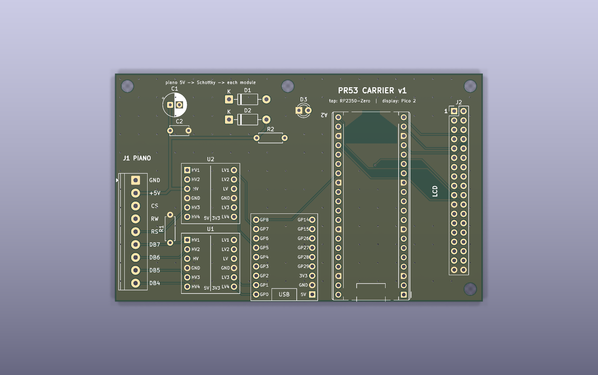
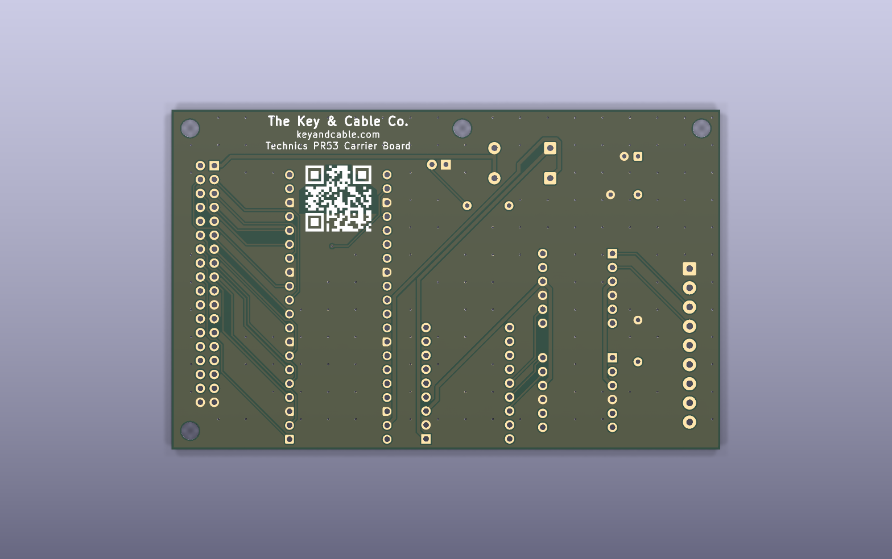

# PR53 Carrier Board (v1)

A 100 x 62 mm 2-layer board that carries the existing two-module build,
socketed on 2.54 mm headers:

    J1 piano in ──► U1/U2 BSS138 shifters ──► A1 RP2350-Zero (tap)
                                                   │ GP8 → GP21 link
                                                   ▼
                              J2 LCD out ◄── A2 Pico 2 (display)

> **Superseded by v2 (one folder up).** These are the files as fabbed in
> October 2026. The shifter footprint on this board is wrong (row spacing, and
> power/GND swapped); see the v2 README. Kept as a record, not rebuildable
> as-is: `keyandcable_qr.txt` and `route.py` live in the v2 folder.

**Status: routed, DRC clean (0 errors, 0 unconnected), Gerbers ready.**




The back silkscreen carries the maker's mark (The Key & Cable Co. /
keyandcable.com / Technics PR53 Carrier Board) and a QR code to
https://keyandcable.com, drawn as vector squares from
`keyandcable_qr.txt` (0.48 mm modules, 12 mm). It sits between the
Pico's pin rows, inside a via-free zone so no drill hole lands in it.

## Before you order: measure two things

These two dimensions come from the common versions of these modules, not
from a datasheet. Check them against your perfboard build:

| Module | Assumed | Constant in `gen_footprints.py` |
|---|---|---|
| RP2350-Zero: long edge to long edge, pin centres | 15.24 mm (6 holes) | `ZERO_COL_SPACING` |
| BSS138 4-ch module: HV row to LV row | 12.70 mm (5 holes) | `SHIFTER_ROW_SPACING` |

The shifter footprint also assumes the SparkFun BOB-12009 pin order (which
the cheap clones copy): `LV1 LV2 LV GND LV3 LV4` opposite
`HV1 HV2 HV GND HV3 HV4`. If either is wrong, change the constant and rebuild
(see below). That takes about five minutes.

## Ordering (JLCPCB or similar)

Upload `pr53_carrier_jlcpcb.zip`. 2 layers, 1.6 mm, everything else default.
All traces are ≥ 0.25 mm, vias 0.7/0.35 mm, so nothing needs the expensive options.

## BOM (all through-hole, hand-solder)

| Ref | Part | Note |
|---|---|---|
| A1 | Waveshare RP2350-Zero + 2x 1x9 headers | USB-C at the bottom edge |
| A2 | Raspberry Pi Pico 2 + 2x 1x20 headers | USB at the bottom edge |
| U1, U2 | BSS138 4-ch level shifter module + 2x 1x6 headers each | |
| J1 | 9-pos 3.5 mm screw terminal (Phoenix PT 1,5/9-3.5-H, or 3+3+3 cheap KF350 blocks) | wire openings face the board edge |
| J2 | 2x18 2.54 mm male header | IDC ribbon → panel, pin 1 marked |
| R1 | 10k axial | **DB7 busy-flag pulldown, needed for the board to work** |
| R2 | 1k axial | power LED |
| D1, D2 | 1N5819 Schottky | 5V into each module (blocks USB back-feed) |
| D3 | 3 mm LED | power |
| C1 | 100 µF 10 V radial, 2.5 mm pitch | |
| C2 | 100 nF ceramic, 5 mm pitch | |

Sockets (female headers) instead of soldering the modules down are a good idea.
The footprints are plain 2.54 mm holes, so either works.

## Wiring (matches the firmware exactly)

**J1, piano in, top to bottom:** GND, +5V, CS, RW, RS, DB7, DB6, DB5, DB4

| Piano | Shifter | Zero |
|---|---|---|
| DB4 | U1 ch4 | GP0 |
| DB5 | U1 ch3 | GP1 |
| DB6 | U1 ch2 | GP2 |
| DB7 (+R1 10k to GND, 5V side) | U1 ch1 | GP3 |
| RS | U2 ch3 | GP4 |
| RW | U2 ch2 | GP5 |
| CS | U2 ch1 | GP7 |
| — | — | GP8 → Pico GP21 (UART link) |

The channel order on the shifters is reversed on purpose, so the lines run
straight across with no crossings. U2 ch4 is spare.

**Shifters are bidirectional on purpose.** The tap firmware answers the
piano's read cycles on DB4-7 (PIO1 in `pr53_emu.c`). A one-way buffer such as
the 74LVC245 in `../../archive/KICAD_NETLIST.md` would break that.

**J2, LCD out:** numbered 1:1 with the HiLetgo 36-pin header (straight-through
ribbon). Pico GP0-15 → DB0-15, GP16 RS, GP17 WR, GP18 RST, CS (pin 21) tied
to GND, 5V on pins 1-2, GND on 35-36.

**Power:** one +5V rail from the piano (J1). It feeds the shifter HV sides
and the LCD directly, and each module through its own Schottky (Zero 5V pin,
Pico VSYS). You can plug USB into either module for reflashing while the
piano is on. The shifter LV side runs from the Zero's 3V3 pin, which is the
same rail as the GPIOs it talks to.

## Rebuilding

Everything is generated, so edit the scripts rather than the board:

```bash
/usr/bin/python3 gen_footprints.py      # pr53.pretty (Zero + shifter footprints)
/usr/bin/python3 gen_board.py           # placement, nets, rules, pours (unrouted)
/usr/bin/python3 route.py freerouting-1.9.0.jar   # autoroute + GND stitching (~1 min)
kicad-cli pcb drc pr53_carrier.kicad_pcb
```

Then re-export the Gerbers (or File → Fabrication Outputs in KiCad).
Freerouting 1.9.0 is the last release that runs on Java 17:
https://github.com/freerouting/freerouting/releases/tag/v1.9.0

Use KiCad's own python (`/usr/bin/python3`), the one that can `import pcbnew`.
Re-running `gen_board.py` discards the routing, so route last. Hand edits in
KiCad are fine once you stop regenerating.

## Not done

- No schematic. The nets live in `gen_board.py` and the board is the source of
  truth. For a pure module carrier that's fine; ask if you want a `.kicad_sch`.
- No 3D models for the modules, so the 3D view shows bare footprints.
